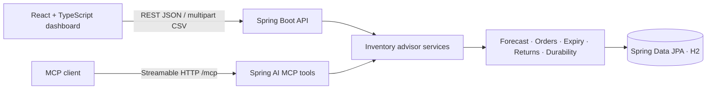

# Architecture

The deterministic Java services are the single source for REST and MCP calculations. The UI does not compute order quantities. H2 is in-memory for the demo. Seeded records are explicitly marked synthetic; CSV-imported records are marked as imported.

## Package responsibilities

- `product`, `supplier`, `sales`, `inventory`: entities and repositories.
- `forecasting`, `recommendations`, `expiry`, `returns`, `durability`, `seasonality`: deterministic domain calculations.
- `importing`: bounded CSV preview and all-or-nothing import.
- `mcp`: annotated tools wrapping shared advisor services.
- `config`: H2, seed data, and local CORS settings.
